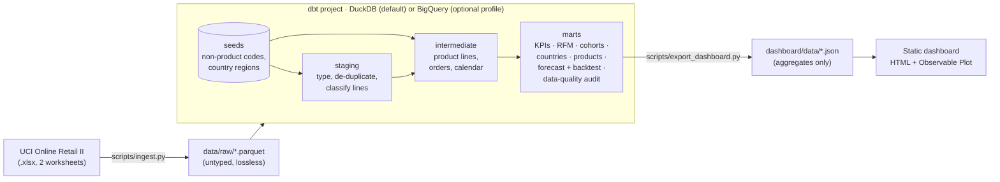

# Decision Support & Revenue Analytics

**Tabi Labs · Internal Engineering** — a case study by [Tabi Digital Solutions](https://tabidigitalsolutions.com)

[](https://github.com/7pearlsmedia-sudo/tabi-revenue-analytics/actions/workflows/ci.yml)
&nbsp;Code: MIT · Data: [CC BY 4.0](DATA_ATTRIBUTION.md)

> **This is not a client project.** It is an internal engineering demo built on a
> public dataset, [UCI Online Retail II](https://doi.org/10.24432/C5CG6D)
> (Chen, 2012, CC BY 4.0). The retailer in the data is not a Tabi client. Every
> number in this README and in the dashboard is computed from that dataset by the
> code in this repository.

---

## 1. Context and problem

A small or mid-sized online retailer usually has its sales history in exports and
spreadsheets, and a commercial team asking the same questions every month:

- **Who are our best customers, and who are we about to lose?**
- **Do new customers come back?** If so, when?
- **Which markets and products carry the business?** And where do cancellations hurt?
- **What should we expect next quarter?** And how far can we trust that number?

This project answers those questions end to end on two years of real transactions
from a UK online giftware wholesaler/retailer (about 1.07 million invoice lines,
Dec 2009 – Dec 2011, 43 countries, amounts in GBP). It does this with a
reproducible, tested pipeline instead of a one-off notebook, so every figure on
the dashboard can be traced back to a rule in code.

**Deliverables**

| | |
|---|---|
| Data pipeline | Python ingestion → DuckDB → dbt (staging → intermediate → marts) |
| Quality | 85 dbt tests incl. revenue reconciliation across marts and an out-of-sample check on the forecast |
| Dashboard | Static, interactive, no backend: [`dashboard/`](dashboard/) |
| CI | GitHub Actions runs ingestion, `dbt build`, docs, export and a reproducibility check on every push |

## 2. Architecture and technical decisions



| Decision | Why |
|---|---|
| **DuckDB as the warehouse** | Free, embedded, fast on 1M rows, identical in local dev and CI. Reads the Parquet files in place (`dbt-duckdb` external source), so there is no load step to maintain. |
| **dbt Core, three layers** | *Staging* only types and classifies (nothing is dropped silently); *intermediate* holds the shared business definitions (what a sale, an order, a complete week is); *marts* answer one question each. Business rules live in versioned SQL with tests and docs, not in a BI tool. |
| **BigQuery as an optional profile** | The models use dbt cross-database macros plus a few dispatched helpers ([`macros/cross_db.sql`](macros/cross_db.sql)), so the same project targets BigQuery with `--target bigquery`. CI only exercises DuckDB; the BigQuery path is provided, not continuously tested. |
| **Seeds for business rules** | The list of non-product stock codes (postage, Amazon fees, bad-debt adjustments, vouchers, tests…) and the country → region map are reviewable CSVs, not magic strings in SQL. |
| **Raw layer kept lossless** | Ingestion writes every column as text. Typing and cleaning happen in dbt, where they are tested. |
| **Simple, honestly evaluated forecast** | Four explainable baselines, one hidden 12-week holdout, error metrics shown next to the chart. A more complex model is only worth it if it beats these numbers. |
| **Static dashboard on pre-aggregated JSON** | No server, no database credentials, free to host anywhere (GitHub Pages, Vercel, Netlify). Only aggregates are exported: no invoice lines, no customer IDs. |
| **Pinned environment** | Python 3.12 (`.python-version`) and an exact lockfile (`uv.lock`); chart libraries are vendored at fixed versions. |

### Data quality: what the pipeline does with the raw lines

All cleaning rules are in [`stg_online_retail__invoice_lines`](models/staging/stg_online_retail__invoice_lines.sql) and
[`int_merchandise_lines`](models/intermediate/int_merchandise_lines.sql); the
[`mart_data_quality`](models/marts/mart_data_quality.sql) model publishes this audit trail:

| Step | Lines | Value (GBP) |
|---|---:|---:|
| Raw invoice lines in the source workbook | 1,067,371 | |
| Removed: worksheet overlap (1–9 Dec 2010 appears in both sheets, row for row) | 22,523 | |
| Removed: exact duplicate lines | 11,812 | |
| Clean lines after de-duplication | 1,033,036 | 18,855,534 |
| Excluded: non-product lines (postage, fees, adjustments, vouchers…) | 5,820 | −71,902 |
| Excluded: zero-price lines and stock write-offs | 5,962 | 0 |
| **Kept: product sales lines** | 1,003,340 | 19,643,862 |
| **Kept: product cancellation lines** | 17,914 | −716,426 |
| of which, lines without a customer id (guest orders) | 227,089 | 2,568,806 |

**Definitions.** *Net revenue* = product sales − product cancellations, at invoice
prices. *Order* = a sales invoice. *Identified customer* = a line with a customer id
(guest orders count toward revenue but not toward customer metrics).
*Complete periods only:* trend charts use whole months (Dec 2009 – Nov 2011) and
whole Monday–Sunday weeks.

**No margin is shown.** The dataset has no cost data, so any "profit" figure would
be an assumption; this project does not make one.

### Tests

`dbt build` runs 85 data tests, including:

- keys are unique and not null at every layer; accepted values for line types, segments and scores;
- every country maps to a region (relationship test to the seed);
- **revenue reconciles**: net revenue summed by line, by country and by product is identical to the penny ([test](tests/assert_revenue_reconciles_across_marts.sql));
- **the forecast holdout is truly out of sample**: exactly N weeks, all after the last training week, each with an actual and a forecast ([test](tests/assert_forecast_holdout_is_out_of_sample.sql));
- every identified customer appears exactly once in the RFM mart; cohort month 0 is 100%.

CI then checks that re-exporting the dashboard data from a fresh build reproduces
the committed JSON ([`check_dashboard_data.py`](scripts/check_dashboard_data.py)).

## 3. What the data shows

All figures are for the full period (1 Dec 2009 – 9 Dec 2011) unless stated.
FY1 = Dec 2009 – Nov 2010, FY2 = Dec 2010 – Nov 2011.

**Scale.** £18.93M net product revenue from 39,516 orders, 5,875 identified
customers in 43 countries and 4,908 products. Cancellations were 3.6% of gross sales.

1. **Revenue is strongly seasonal and was flat year over year.** September to
   November produced 38% of FY2 net revenue; November 2011 (£1.43M) was 3.0× the
   weakest month, April 2011. Total net revenue grew 1.9% from FY1 to FY2, and the UK,
   85% of revenue, was flat (−0.1%).

2. **A quarter of customers bring almost three quarters of revenue.** The RFM
   "Champions" segment is 27% of identified customers and 72% of their net
   revenue. 968 customers in "At risk" and "Cannot lose them" ordered often in
   the past but not for about a year; they represent £1.67M of historical
   revenue, which makes them the obvious target list for a win-back campaign.

3. **The first repeat order is the critical step.** Across 22 monthly cohorts,
   about 21% of new customers order again the following month and about 18% are
   still ordering in month 12. Retention is roughly flat after month 1 rather than
   decaying, so whoever comes back once tends to keep coming back.

4. **Revenue is concentrated in products and in export accounts.** 1,047 of 4,908
   products (21%) generate 80% of net revenue. The largest non-UK market, Ireland
   (£603k, 3.2% of revenue), comes from just 3 identified customers.

5. **Seasonality is the forecasting signal.** On a 12-week holdout (Sep–Nov 2011)
   that no method saw, "same week last year" has a weighted absolute percentage error
   (WAPE) of 14.8%, against 33.6% for "last week, held flat" and 41.8% for a
   4-week moving average. Adjusting the seasonal forecast for trailing YoY growth
   improves WAPE only marginally (14.76% vs 14.83%) and moves the bias from −3.0%
   to +5.6%. That is reported as is: the simplest seasonal baseline is
   already hard to beat.

**Caveats that matter for interpretation**

- The two largest single products by *gross* sales are distorted by two bulk orders
  (80,995 and 74,215 units) that were cancelled the same day. They net to zero, which
  is why this project reports *net* revenue and shows return rates next to it.
- The Dec 2009 cohort contains customers who bought before the data starts, so it is
  excluded from retention averages.
- 13.6% of net revenue comes from guest orders without a customer id; customer-level
  metrics (RFM, cohorts) cover identified customers only.

## 4. Run it yourself

Requirements: [uv](https://docs.astral.sh/uv/) (it installs Python 3.12 for you), ~200 MB free disk.

```bash
uv sync --frozen                         # pinned environment
uv run python scripts/ingest.py          # download UCI data -> data/raw/*.parquet (~1 min)
uv run dbt build                         # seeds + models + tests into warehouse.duckdb
uv run dbt docs generate && uv run dbt docs serve   # optional: lineage and column docs
uv run python scripts/export_dashboard.py           # marts -> dashboard/data/*.json
python -m http.server 8000 --directory dashboard    # open http://localhost:8000
```

If your OS blocks the `dbt` launcher executable (some Windows application-control
policies do), use `uv run python -m dbt.cli.main build` instead.

### Running on BigQuery (optional)

```bash
uv sync --frozen --extra bigquery
gcloud auth application-default login
export BQ_PROJECT=your-project BQ_DATASET=tabi_revenue_analytics BQ_LOCATION=EU RAW_SCHEMA=raw
bq mk --dataset --location=EU $BQ_PROJECT:raw
bq load --source_format=PARQUET raw.invoice_lines "data/raw/online_retail_*.parquet"
uv run dbt build --target bigquery
```

The BigQuery target is provided for teams that already run there; it is not part
of CI.

### Configuration

Forecast settings are dbt vars in [`dbt_project.yml`](dbt_project.yml):
`forecast_holdout_weeks` (12), `forecast_horizon_weeks` (12),
`forecast_growth_window_weeks` (12). For example:
`uv run dbt build --vars '{forecast_holdout_weeks: 8}'`.

## 5. Repository layout

```
scripts/ingest.py               download + land raw data as Parquet
models/staging/                 typed, de-duplicated, classified lines (+ source)
models/intermediate/            product lines, orders, calendar bounds
models/marts/                   one model per business question
seeds/                          non-product stock codes, country -> region
tests/                          reconciliation and forecast-integrity tests
macros/                         cross-database helpers, schema naming, generic test
scripts/export_dashboard.py     marts -> dashboard/data/*.json
scripts/check_dashboard_data.py CI reproducibility check
dashboard/                      static dashboard (HTML, CSS, JS, vendored d3 + Plot)
.github/workflows/ci.yml        CI
```

## 6. Attribution and license

- Data: Chen, D. (2012). *Online Retail II* [Dataset]. UCI Machine Learning Repository.
  [doi:10.24432/C5CG6D](https://doi.org/10.24432/C5CG6D). CC BY 4.0. See
  [DATA_ATTRIBUTION.md](DATA_ATTRIBUTION.md) for what was changed.
- Code: MIT, see [LICENSE](LICENSE).
- Vendored libraries: [d3](https://d3js.org) and [Observable Plot](https://observablehq.com/plot/), both ISC.

---

Built by Tabi Labs, the internal engineering practice of
[Tabi Digital Solutions](https://tabidigitalsolutions.com).
